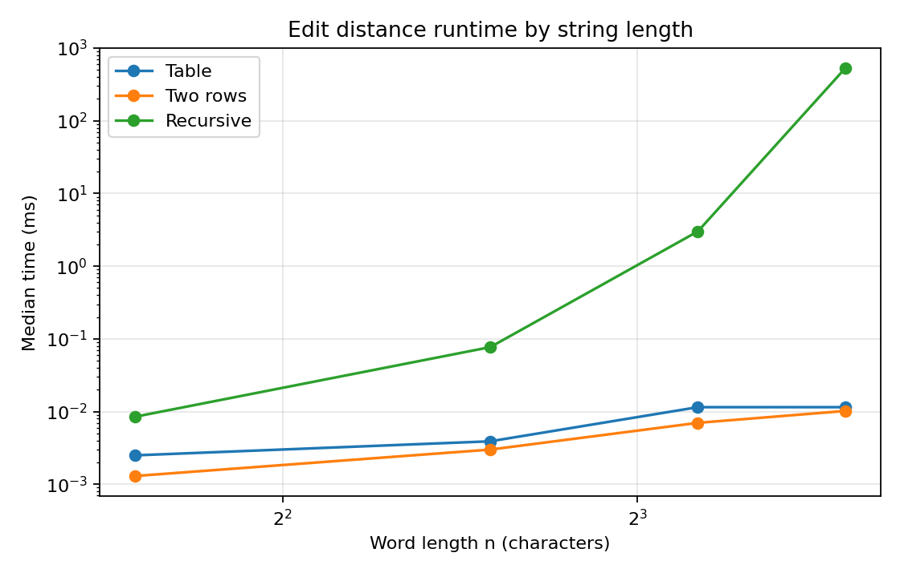
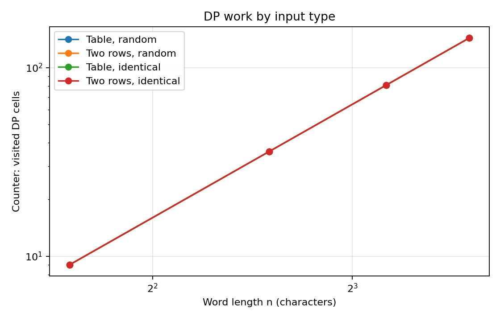
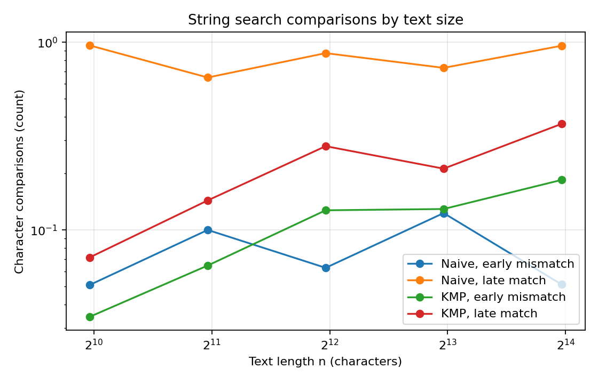

# Assignment 4: Dynamic Programming and String Algorithms

https://github.com/NeoOSus/DAA-ASN4.git

## Experiment Design Card

| Field | Plan |
|---|---|
| Question | How do the three edit-distance methods scale, and how do Naive and KMP search costs change with input size and mismatch position? |
| Sizes (n) | Edit distance: 3, 6, 9, 12 characters (4x range; recursive stays manageable). Search: 1,000, 2,000, 4,000, 8,000, 16,000 text characters. |
| Inputs | Edit distance: seeded random strings and identical strings. Search: pattern mismatches at its first character, and repeated `a` text with a pattern `a...ab` whose last character matches only at the end. |
| Metrics | Median time of three runs. Edit counter: recursive calls or DP cells computed. Search counter: character comparisons performed inside each search. These counters show work without relying only on laptop speed. |
| Prediction | Recursive edit distance will grow very fast. Both DP versions will do about n² cells; two rows should use less memory. Naive search should be cheap for an early mismatch and costly for a late mismatch; KMP should grow close to linearly with text length. |
| Plots | Runtime plot compares edit-distance methods; DP-cell plot compares inputs and versions; search-comparison plot shows the effect of mismatch position. Log axes make growth easier to compare. |

The design above was fixed before running the experiment. Generator seed: `424242`; the same command produces the same strings and counters. Each time is the median of three runs.

## Plots and Results

The recursive method rises sharply, while the table and two-row times remain small at these sizes.

The two DP versions visit the same number of cells; identical input does not skip cells in this implementation.

Naive search performs far more comparisons when the mismatch happens at the end of a long partial match.

At length 12, recursion made 377393953 calls and took 528.156800 ms, while table DP computed 144 cells (0.011500 ms) and two rows computed 144 cells (0.010200 ms). At text length 16,000, Naive used 15969 comparisons for early mismatch and 511008 for the late-match case; KMP used 31968 comparisons on the late-match case. Times are machine-dependent and small timings can be noisy.

## Prediction vs Result

For edit distance, I expected recursion to be much slower because it solves the same smaller problems many times. The call counter confirms this: at n=12 it made 377393953 calls, compared with 144 cells for table DP. The two DP versions had the same work counter, but two rows keep only O(m) extra memory instead of the full O(nm) table.

For searching, I expected Naive to be sensitive to how many characters match before failure. The experiment showed 511008 comparisons for late mismatch and 15969 for immediate mismatch at n=16,000. KMP had 31968 comparisons on the late case because it reuses prefix information. Results support the prediction, although wall-clock values fluctuate at low durations.

## Short Answers

**Which input made string search slowest, and why?**  
The repeated `a` text with a pattern ending in `b` was hardest for Naive. At most positions it matched 31 characters and then failed on the last one, so it repeated almost the same work many times. It needed 511008 character comparisons at the largest size. KMP remembers the matching prefix and avoids restarting from the beginning.

**How large an n could recursive Edit Distance handle, and what stopped it?**  
In my experiment it completed up to n=12, but even that took 528.156800 ms and made 377393953 recursive calls. I stopped at 12 because the call count grows exponentially and bigger sizes would take too long. This is a practical limit for this simple implementation, not a formal maximum.

**What do you gain and lose with two rows?**  
Two rows reduce extra memory from O(nm) to O(m), which matters for long strings. The answer is still exact and the running time stays O(nm). I lose the full table, so I cannot easily backtrack through it to show the actual sequence of edits.

**Which search would I choose for the city platform?**  
I would choose KMP for searching user-provided patterns in long texts because it gives predictable O(n+m) work, including inputs with many repeated characters. The returned positions include overlaps. Naive is shorter and can be fine for tiny inputs, but its worst case is less predictable.

## One Paragraph on Time

I recorded the median of three runs, but time is not my only evidence because JVM startup, scheduling and other laptop activity affect short runs. The comparison counters are more stable and directly show how much character or DP work each method performed. The plots use log axes to make the different growth rates visible. The recursive method is intentionally limited to small inputs, and the timings should be read as observations on this machine rather than universal benchmarks.
